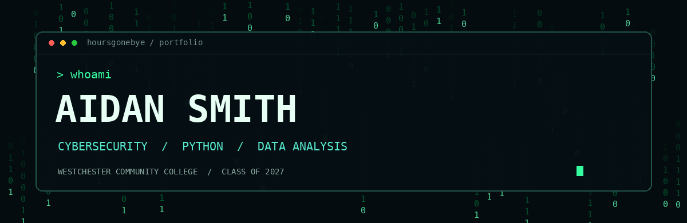
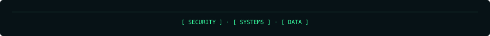

 

  

Cybersecurity student &nbsp; · &nbsp; IT help desk &nbsp; · &nbsp; Home lab

  

[PROJECTS](#recent-projects) &nbsp; / &nbsp; [TOOLKIT](#technical-toolkit) &nbsp; / &nbsp; [CURRENT FOCUS](#current-focus)

Westchester Community College · AAS Cybersecurity, expected May 2027

 

I'm a cybersecurity student at Westchester Community College, where I also work on the IT help desk. I like working with Linux, figuring out why something broke, and writing Python to understand a problem.

Outside the classroom, I run a home lab with Proxmox, Wazuh, and Pi-hole. Lately, I’ve been spending more time with Python, working through data analysis and basic model training in Jupyter notebooks.

I'm working toward a Computer Science transfer after my AAS and want to build a career in cybersecurity.

My latest notebooks, starting with the most recent. These are learning projects using small, fictional datasets.

<table>
<tr>
<td width="50%" valign="top">

### [PyTorch Pass/Fail Classifier](https://github.com/hoursgonebye/pytorch-pass-fail-classifier)

A PyTorch notebook predicting pass/fail outcomes from fictional study-hour data. I worked through the training loop, logits, probabilities, and evaluation.

- Trains a linear model with binary cross-entropy loss and SGD.
- Evaluates four held-out examples against an always-pass baseline.
- Explains prediction confidence and the limits of a tiny dataset.

<kbd>Python</kbd> <kbd>PyTorch</kbd> <kbd>Jupyter</kbd>

</td>
<td width="50%" valign="top">

### [Linear Regression from Scratch](https://github.com/hoursgonebye/numpy-linear-regression-from-scratch)

Linear regression in NumPy, predicting fictional game damage from character strength. Writing out the gradients helped me understand how the weight and bias change during training.

- Updates weight and bias over 1,000 training steps.
- Compares training and test error with a mean-value baseline.
- Visualizes the fitted line and discusses extrapolation.

<kbd>Python</kbd> <kbd>NumPy</kbd> <kbd>Matplotlib</kbd>

</td>
</tr>
<tr>
<td width="50%" valign="top">

### [pandas Game Score Analysis](https://github.com/hoursgonebye/pandas-game-score-analysis)

Cleaning a small game-score dataset with pandas, then comparing players and exporting the results. This was practice handling missing values, duplicates, and grouped summaries.

- Handles missing scores and removes duplicate records.
- Groups results by player to compare averages and score ranges.
- Explains how incomplete observations affect comparisons.

<kbd>Python</kbd> <kbd>pandas</kbd> <kbd>Matplotlib</kbd>

</td>
<td width="50%" valign="top">

### [NumPy Game Score Analysis](https://github.com/hoursgonebye/numpy-game-score-analysis)

My first score-analysis notebook: three players, five rounds, and a look at averages, consistency, and changes over time using NumPy and Matplotlib.

- Calculates player means and standard deviations.
- Uses bar and line charts to compare performance.
- Interprets observed patterns without claiming future results.

<kbd>Python</kbd> <kbd>NumPy</kbd> <kbd>Matplotlib</kbd>

</td>
</tr>
</table>

| Area | Tools I use |
| :--- | :--- |
| Programming | Python, Bash, Git |
| Data analysis | NumPy, pandas, Matplotlib, Jupyter Notebook |
| Model fundamentals | Linear regression, gradient descent, binary classification, PyTorch |
| Systems and infrastructure | Linux, Debian, Docker, Proxmox, Raspberry Pi |
| Security lab | Wazuh, Pi-hole, centralized logging, network monitoring |

- **Python and data:** strengthening fundamentals through analysis, visualization, and small modeling experiments.
- **Systems and security:** continuing to develop the home lab, with attention to backups, firewall policy, and network segmentation.
- **IT support:** building practical troubleshooting experience through college help-desk work.
- **Education:** completing the Cybersecurity AAS, expected May 2027, and preparing for a Computer Science transfer.

I learn best when I can change something and see what happens. In the lab, that means setting up services and troubleshooting them. In a notebook, it means trying the calculation, checking the output, and explaining it in my own words.

I keep the results and limitations in the repositories so it’s clear what each project actually does.

 

