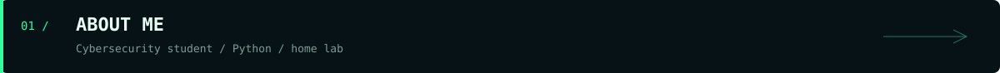
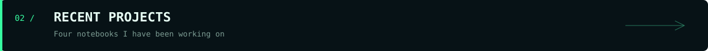
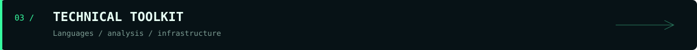
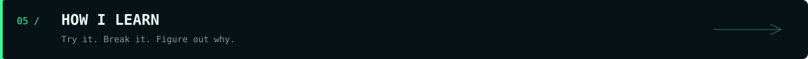

 

  

<kbd>CYBERSECURITY STUDENT</kbd> &nbsp; <kbd>IT HELP DESK</kbd> &nbsp; <kbd>HOMELAB BUILDER</kbd>

  

[PROJECTS](#recent-projects) &nbsp; / &nbsp; [TOOLKIT](#technical-toolkit) &nbsp; / &nbsp; [CURRENT FOCUS](#current-focus)

Westchester Community College · AAS Cybersecurity, expected May 2027

 

I'm a cybersecurity student at Westchester Community College, where I also work on the IT help desk. My interests connect security, Linux systems, and Python: understanding how systems behave, working through problems, and using data to explain what happened.

Outside the classroom, I run a home lab with Proxmox, Wazuh, and Pi-hole. My recent projects explore data cleaning, numerical analysis, and the foundations of model training through small, focused notebooks.

I aim to make each project easy to follow: a clear question, readable code, visible results, and an explanation of what those results can and cannot tell us. I'm preparing for a Computer Science transfer and a career in cybersecurity.

My four newest projects follow a progression from exploring arrays and cleaning data to implementing regression and training a binary classifier. Each uses fictional data to keep the focus on the underlying concepts.

<table>
<tr>
<td width="50%" valign="top">

PROJECT 01 / NOTEBOOK

### [PyTorch Pass/Fail Classifier](https://github.com/hoursgonebye/pytorch-pass-fail-classifier)

A small binary classifier that predicts fictional pass/fail outcomes from hours studied. The notebook follows the process from logits and probabilities to training, predictions, and evaluation.

- Trains a linear model with binary cross-entropy loss and SGD.
- Evaluates four held-out examples against an always-pass baseline.
- Explains prediction confidence and the limits of a tiny dataset.

<kbd>Python</kbd> <kbd>PyTorch</kbd> <kbd>Jupyter</kbd>

</td>
<td width="50%" valign="top">

PROJECT 02 / NOTEBOOK

### [Linear Regression from Scratch](https://github.com/hoursgonebye/numpy-linear-regression-from-scratch)

An implementation of linear regression using NumPy to predict fictional game damage from character strength. The training loop exposes how predictions, errors, and gradients drive parameter updates.

- Updates weight and bias over 1,000 training steps.
- Compares training and test error with a mean-value baseline.
- Visualizes the fitted line and discusses extrapolation.

<kbd>Python</kbd> <kbd>NumPy</kbd> <kbd>Matplotlib</kbd>

</td>
</tr>
<tr>
<td width="50%" valign="top">

PROJECT 03 / NOTEBOOK

### [pandas Game Score Analysis](https://github.com/hoursgonebye/pandas-game-score-analysis)

A data-cleaning and analysis workflow for fictional game scores. The notebook moves from inspecting raw records to creating player summaries, a comparison chart, and reusable CSV exports.

- Handles missing scores and removes duplicate records.
- Groups results by player to compare averages and score ranges.
- Explains how incomplete observations affect comparisons.

<kbd>Python</kbd> <kbd>pandas</kbd> <kbd>Matplotlib</kbd>

</td>
<td width="50%" valign="top">

PROJECT 04 / NOTEBOOK

### [NumPy Game Score Analysis](https://github.com/hoursgonebye/numpy-game-score-analysis)

An introduction to numerical analysis through scores for three players across five rounds. The project explores how average performance, consistency, and trends describe different aspects of the same data.

- Calculates player means and standard deviations.
- Uses bar and line charts to compare performance.
- Interprets observed patterns without claiming future results.

<kbd>Python</kbd> <kbd>NumPy</kbd> <kbd>Matplotlib</kbd>

</td>
</tr>
</table>

| `DOMAIN` | `TOOLS / PRACTICE` |
| :--- | :--- |
| Programming | Python, Bash, Git |
| Data analysis | NumPy, pandas, Matplotlib, Jupyter Notebook |
| Model fundamentals | Linear regression, gradient descent, binary classification, PyTorch |
| Systems and infrastructure | Linux, Debian, Docker, Proxmox, Raspberry Pi |
| Security lab | Wazuh, Pi-hole, centralized logging, network monitoring |

- **Python and data:** strengthening fundamentals through analysis, visualization, and small modeling experiments.
- **Systems and security:** continuing to develop the home lab, with attention to backups, firewall policy, and network segmentation.
- **IT support:** building practical troubleshooting experience through college help-desk work.
- **Education:** completing the Cybersecurity AAS, expected May 2027, and preparing for a Computer Science transfer.

I use focused projects to connect theory with something I can run, inspect, and explain. For analysis work, that means preserving the original data, checking the effects of cleaning decisions, and showing the outputs alongside the code. For modeling work, it means comparing against a simple baseline and separating observed results from broader claims.

These repositories document that learning process, including the assumptions, small datasets, and limitations that give the results context.

 

